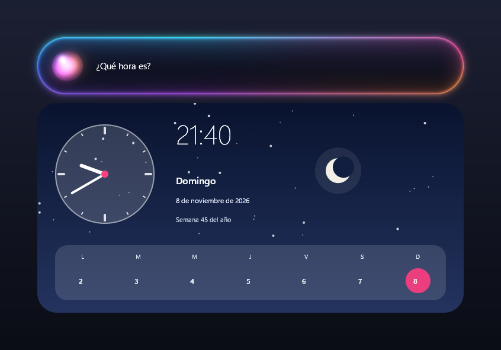
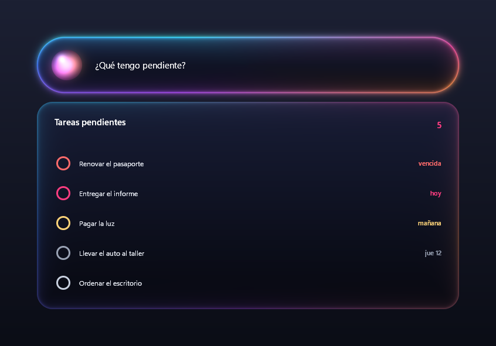

<p align="center">
  
</p>

<h1 align="center">Node Assistant</h1>

<p align="center">
  Un asistente de voz para Windows: aprietas <b>Ctrl + Alt + N</b>, le hablas y te contesta en voz alta.<br>
  Usa IA gratis en la nube, con respaldo local, y guarda su memoria, tus tareas y tu diario en Obsidian.
</p>

<p align="center">
  <a href="README.md">English</a> · <b>Español</b>
</p>

<p align="center">
  
  
</p>

> **100 % vibecoded.** Todo el código de este proyecto lo escribió una IA (Claude), guiada por mí con pedidos,
> pruebas y correcciones. Lo comparto tal cual porque me resulta útil; no tuvo una revisión de seguridad profesional.

## Qué hace

- **Voz de ida y vuelta.** Una cápsula de vidrio baja desde arriba de la pantalla. El orbe queda gris mientras el
  micrófono arranca y, cuando ya te escucha, destella y suena un sable láser: ahí hablas. Te entiende con Whisper
  (o Groq, más rápido) y te contesta con una voz de Piper, sin internet.
- **Hace cosas en la PC:** abre apps, carpetas y juegos de Steam; busca en Google, YouTube y Spotify; maneja el
  volumen y la música; captura la pantalla; bloquea la PC; mira la pantalla y te explica lo que ves; encuentra un
  botón y le hace clic; corre comandos de PowerShell (preguntando antes de cambiar algo).
- **Tarjetas ilustradas:** el clima, la hora y el día, tus tareas. Las respuestas largas se leen en un panel con
  scroll (y no se dicen en voz alta, para no cansar).
- **Obsidian como segundo cerebro:** notas rápidas, listas, tareas con fecha, bases tipo Notion ("agrega Dune a mis
  películas, le doy 9", "¿cuánto gasté este mes?"), una nota por día y preguntas a tus notas ("¿qué anoté sobre la
  tesis?"). Funciona con la [plantilla de bóveda de kepano](https://github.com/kepano/kepano-obsidian).
- **Resumen del día a las 20:00 por Telegram**, y un bot para usar a Node desde el celular (texto o audios).
- **Recordatorios, Gmail y Google Calendar, Discord, OBS, GitHub** y el estado de la PC.
- **Abierto a tus modelos:** cualquier proveedor compatible con OpenAI, cualquier modelo de Ollama, tu propio
  archivo GGUF y tu propia voz de Piper. Todo se configura con `/setup`, sin tocar código.
- **6 idiomas:** español, inglés, portugués, francés, alemán e italiano. Arranca en el idioma de tu Windows.
- **Modo privado (`/opsec`):** nada sale de tu PC; usa solo modelos locales.

## Quick Start

### 1. Lo que necesitas

| | |
|---|---|
| **Windows 10 u 11** | Usa la API de Windows para la ventana, el atajo y el sonido. |
| **[Python 3.12](https://www.python.org/downloads/)** | Al instalarlo, marca *Add python.exe to PATH*. |
| **Micrófono y parlantes** | |
| **[Ollama](https://ollama.com/download)** (opcional, recomendado) | El respaldo local cuando no hay internet o se acaba el cupo gratis, y el modo `/opsec`. |

### 2. Descargar e instalar

En PowerShell, en la carpeta donde lo quieras:

```powershell
git clone https://github.com/PollNull/NodeAssistant.git
cd NodeAssistant
py -3.12 -m venv .venv
.venv\Scripts\python.exe -m pip install -r requirements.txt
```

### 3. Arrancar y configurar con `/setup`

```powershell
.venv\Scripts\pythonw.exe node_assistant.py
```

La primera vez se abre solo el asistente de configuración (después, cuando quieras, escribe `/setup` en la
cápsula). Recién instalado, Node no tiene ningún modelo ni voz: los eliges ahí, paso a paso.

1. **Tu nombre y tu idioma:** español, inglés, portugués, francés, alemán o italiano. Arranca en el idioma de
   tu Windows (si no es uno de esos, en inglés). Node te entiende, te responde, habla y muestra todo en ese idioma.
2. **IA en la nube.** Elige un proveedor (Groq, Gemini, OpenRouter, NVIDIA, Mistral, SambaNova, Hugging Face,
   DeepSeek, Ollama o cualquier otro compatible con OpenAI), pega tu clave, toca **Buscar modelos** para ver los que
   ofrece, **Probar** y **Guardar**. Con uno alcanza; con varios, si uno se queda sin cupo, Node pasa al siguiente.
3. **Modelos en tu PC** (opcional, con [Ollama](https://ollama.com/download)). Descargas modelos abiertos con un
   botón (llama3.2, qwen2.5, gpt-oss, laya), cualquier otro de [ollama.com/library](https://ollama.com/library) por
   su nombre, o **importas tu propio archivo GGUF**. Eliges con cuál charla Node sin internet.
4. **Voz.** Descargas una voz de [Piper](https://github.com/rhasspy/piper) (México, Argentina, España) o importas la
   tuya (`.onnx`). Y Whisper, para que te entienda sin internet (unos 460 MB; con la clave de Groq no hace falta).
5. **Memoria** (opcional). Eliges la carpeta y Node crea ahí una bóveda de Obsidian. Si tienes Obsidian, lo
   encuentra solo y suma la bóveda a su lista; si no, te da el enlace para bajarlo. Puedes sumar la
   [plantilla de kepano](https://github.com/kepano/kepano-obsidian). Sin memoria, Node funciona igual pero no recuerda.
6. **Preferencias:** iniciar con Windows, leer las respuestas en voz alta, el micrófono, el modo privado, el
   resumen del día por Telegram y los colores de la cápsula.

Al terminar, Node se reinicia con todo aplicado. Aprieta **Ctrl + Alt + N**, espera el destello del orbe y habla.
También puedes escribir en la cápsula y apretar Enter. Para cerrarlo: di o escribe "salir".

Después, **`/settings`** abre los ajustes, por secciones: General (nombre, idioma, inicio con Windows, colores), IA en
la nube, Modelos locales, Voz y micrófono (voz, largo máximo para leer en voz alta, espera del micrófono), Memoria
(bóveda, resumen del día y su hora), Herramientas (prender o apagar cada una), Plugins, Servicios (Telegram, Discord, OBS, Cloudflare, Google) y Avanzado
(personalidad, creatividad, Whisper, modo privado).

### Las claves, por dentro

Node no guarda claves en archivos: `/setup` las guarda en las **variables de entorno de tu usuario de Windows**, y
el resto de cada proveedor en `proveedores.json`. Si prefieres hacerlo a mano, estas son las de fábrica:

| Plataforma | Para qué | Variable | Dónde se consigue |
|---|---|---|---|
| **Groq** (recomendada) | Charla rapidísima y transcribir tu voz en 0,3 s. No guarda lo que le mandas. | `GROQ_API_KEY` | [console.groq.com/keys](https://console.groq.com/keys) |
| **Gemini** | Respaldo y **visión** (mirar tu pantalla, el mouse). En el plan gratis, Google puede usar tus datos. | `GEMINI_API_KEY` | [aistudio.google.com/apikey](https://aistudio.google.com/apikey) |
| **OpenRouter** | Respaldo con modelos `:free`. | `OPENROUTER_API_KEY` | [openrouter.ai/settings/keys](https://openrouter.ai/settings/keys) |
| **Cloudflare Workers AI** | Otro respaldo. | `CLOUDFLARE_API_TOKEN` y `CLOUDFLARE_ACCOUNT_ID` | [dash.cloudflare.com](https://dash.cloudflare.com) → Workers AI |

En PowerShell, sin que la clave quede a la vista ni en el historial:

```powershell
function Set-ApiKey($Name) {
  $s = Read-Host "Pega la clave para $Name" -AsSecureString
  $k = [Runtime.InteropServices.Marshal]::PtrToStringAuto([Runtime.InteropServices.Marshal]::SecureStringToBSTR($s))
  [Environment]::SetEnvironmentVariable($Name, $k, 'User'); "Guardada $Name"
}
Set-ApiKey GROQ_API_KEY
```

### Hazlo tuyo

- **La personalidad:** en `/settings` → Avanzado. Es lo que más cambia cómo habla.
- **Tus apps favoritas:** `apps.json`, con una descripción corta en inglés (así Node sabe cuál abrir cuando pides
  "pon algo de música").

Probar qué haría con una frase, sin abrir nada:

```powershell
.venv\Scripts\python.exe node_assistant.py --dry "pon algo de música"
```

## Cómo se usa

| Dices | Pasa |
|---|---|
| "Abre Spotify", "pon Daft Punk en YouTube" | Abre la app o el video |
| "¿Qué hora es?", "¿cómo está el clima?" | Lo dice y muestra una tarjeta |
| "Avísame en 20 minutos que saque la pizza" | Un recordatorio (también te llega a Telegram) |
| "Tengo que pagar el gas el lunes", "¿qué tengo pendiente?" | Tareas en Obsidian, con tarjeta |
| "Agrega Interstellar a mis películas, le doy 9" | Una nota en tu bóveda, que aparece en su tabla |
| "¿Qué es este error?" | Mira tu pantalla y te lo explica |
| "Haz clic en Aceptar" | Lo encuentra, te lo señala y pregunta antes de hacer clic |
| "¿Qué hice ayer?" | Lee el resumen de tu diario |

Comandos que se escriben en la cápsula o en Telegram: `/help` (todos), `/usage` (cupo gratis que queda),
`/setup` (configuración paso a paso), `/settings` (ajustes), `/feeling` (colores de la cápsula), `/opsec` (modo privado), `/mictoggle`, `/micavailtogg`, `/tgtoggle`, `/resumen`.

## Plugins

Cada archivo de `plugins/` suma habilidades y explica arriba cómo se configura: Telegram, Discord, OBS, Gmail y
Google Calendar, GitHub, Steam y más. Sus claves se cargan en `/settings` → **Servicios**.

### Instalar uno

`/settings` → **Plugins** → **Instalar desde enlace** (pega el enlace de GitHub al archivo `.py`) o **Instalar desde un
archivo…**. Entra **apagado**: tócalo en **Ver código**, préndelo y toca **Guardar y reiniciar**. Desde esa misma
sección se apagan o se quitan (quedan en `plugins_quitados/`, por si te arrepientes).

> ⚠️ Un plugin es código que corre con los mismos permisos que Node: puede leer tus archivos y usar internet.
> Instala solo los de alguien en quien confíes.

### Crear uno sin programar

- **En GitHub:** abre un issue con la plantilla **Nuevo plugin**. Pones el nombre, qué hace, el tipo (consultar una
  API, abrir una búsqueda o abrir un programa) y la dirección. Una Action arma el plugin, lo prueba y abre un pull
  request; en el issue te deja avisos si la página probablemente no funcione (pide iniciar sesión, bloquea robots,
  usa Cloudflare, se arma con JavaScript o no devuelve datos). Para que la Action pueda abrir el pull request:
  Settings → Actions → General → *Allow GitHub Actions to create and approve pull requests*.
- **En tu PC:** `.venv\Scripts\python.exe tools\crear_plugin.py` te hace las mismas preguntas y lo deja en `plugins/`.

Para escribir uno a mano, mira [plugins/LEEME.md](plugins/LEEME.md).

## Idiomas

Node usa el idioma de tu Windows (o el que elijas en `/settings` → General). Los textos fijos están en
`idiomas/<código>.json`, traducidos del español con IA por `tools/traducir.py`: se pueden corregir a mano. Si
cambias o agregas textos en el código, márcalos con `t('…')` (o `node.t('…')` en un plugin) y vuelve a correr
`tools\traducir.py`: traduce solo lo que falta. Las órdenes sin internet (las reglas de palabras clave) por ahora
solo entienden español; con IA en la nube, Node entiende cualquiera de los 6 idiomas.

## Privacidad

- El micrófono no graba nada hasta que aprietas el atajo. Con "Siempre listo" queda abierto, pero solo guarda en
  memoria el último medio segundo, que se pisa todo el tiempo.
- Lo que dices viaja a la plataforma de IA que esté respondiendo; la visión manda capturas de pantalla. Groq no
  guarda lo que le mandas; Gemini y Mistral gratis pueden usarlo para entrenar.
- Tus datos (ajustes, proveedores, recordatorios, ubicación, permisos de Google) quedan en archivos de la carpeta que nunca se
  suben a git. Tu memoria y tu diario, en tu bóveda de Obsidian.
- Con `/opsec`, nada sale de tu PC.

## Licencia

[0BSD](LICENSE): haz lo que quieras con el código.
