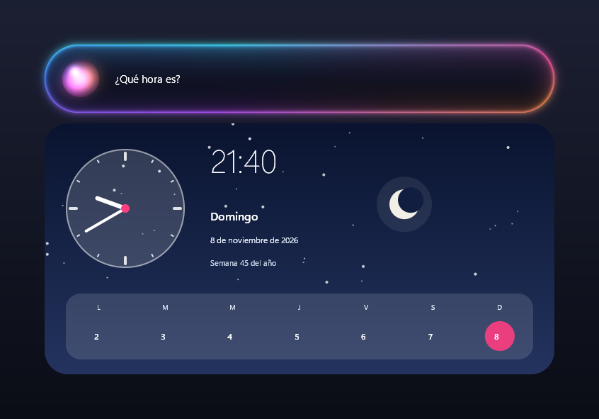
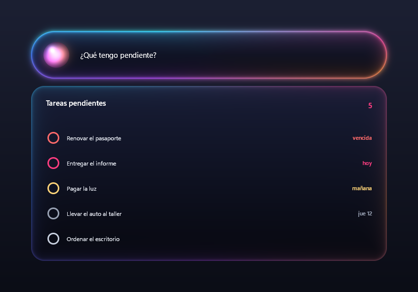

<p align="center">
  
</p>

<h1 align="center">Node Assistant</h1>

<p align="center">
  A voice assistant for Windows: press <b>Ctrl + Alt + N</b>, talk to it, and it answers out loud.<br>
  It uses free cloud AI with a local fallback, and keeps its memory, your tasks and your journal in Obsidian.
</p>

<p align="center">
  <b>English</b> · <a href="README.es.md">Español</a>
</p>

<p align="center">
  
  
</p>

> **100% vibecoded.** All the code in this project was written by an AI (Claude), guided by me through requests,
> testing and corrections. I'm sharing it as is because I find it useful; it has not had a professional security
> review.

## What it does

- **Two-way voice.** A glass capsule slides down from the top of the screen. The orb stays gray while the
  microphone starts up and, once it's actually listening, it flashes and a lightsaber sound plays: that's your cue
  to speak. It understands you with Whisper (or Groq, which is faster) and answers with a Piper voice, offline.
- **Does things on your PC:** opens apps, folders and Steam games; searches Google, YouTube and Spotify; controls
  volume and music; takes screenshots; locks the PC; looks at your screen and explains what it sees; finds a button
  and clicks it; runs PowerShell commands (asking before it changes anything).
- **Illustrated cards:** the weather, the time and date, your tasks. Long answers are shown in a scrollable panel
  (and not read aloud, so they don't wear you out).
- **Obsidian as a second brain:** quick notes, lists, tasks with due dates, Notion-style databases ("add Dune to my
  movies, I give it a 9", "how much did I spend this month?"), a daily note and questions about your notes ("what did
  I write about my thesis?"). Works with [kepano's vault template](https://github.com/kepano/kepano-obsidian).
- **A summary of your day at 8 PM on Telegram**, and a bot to use Node from your phone (text or voice messages).
  Everyone creates **their own bot**, tied to their PC: in `/settings` → Services → Telegram you paste its token and
  send it a 6-digit code shown on your screen. From then on it only obeys your chat.
- **Reminders, Gmail and Google Calendar, Discord, OBS, GitHub** and your PC's status.
- **Skills:** routines and styles written in plain text ("work mode", "good night"), no code needed.
- **Open to your own models:** any OpenAI-compatible provider, any Ollama model, your own GGUF file and your own
  Piper voice. Everything is set up with `/setup`, no code required.
- **6 languages:** English, Spanish, Portuguese, French, German and Italian. It starts in your Windows language.
- **Private mode (`/opsec`):** nothing leaves your PC; it only uses local models.

## Quick Start

### 1. What you need

| | |
|---|---|
| **Windows 10 or 11** | It uses the Windows API for the window, the shortcut and sound. |
| **[Python 3.12](https://www.python.org/downloads/)** | When installing it, check *Add python.exe to PATH*. |
| **A microphone and speakers** | |
| **[Ollama](https://ollama.com/download)** (optional, recommended) | The local fallback when there's no internet or the free quota runs out, and for `/opsec` mode. |

### 2. Download and install

In PowerShell, in the folder where you want it:

```powershell
git clone https://github.com/PollNull/NodeAssistant.git
cd NodeAssistant
py -3.12 -m venv .venv
.venv\Scripts\python.exe -m pip install -r requirements.txt
```

### 3. Start it and set it up with `/setup`

```powershell
.venv\Scripts\pythonw.exe node_assistant.py
```

The first time, the setup wizard opens by itself (later, type `/setup` in the capsule whenever you want). Freshly
installed, Node has no models or voice: you pick them there, step by step.

1. **Your name and language:** English, Spanish, Portuguese, French, German or Italian. It starts in your Windows
   language (English if yours isn't one of those). Node understands you, answers, speaks and shows everything in
   that language.
2. **Cloud AI.** Pick a provider (Groq, Gemini, OpenRouter, NVIDIA, Mistral, SambaNova, Hugging Face, DeepSeek,
   Ollama or any other OpenAI-compatible one), paste your key, click **Search models** to see what it offers, then
   **Test** and **Save**. One is enough; with several, if one runs out of quota Node moves on to the next.
3. **Models on your PC** (optional, with [Ollama](https://ollama.com/download)). Download open models with one click
   (llama3.2, qwen2.5, gpt-oss, laya), any other from [ollama.com/library](https://ollama.com/library) by name, or
   **import your own GGUF file**. Choose which one Node chats with when offline.
4. **Voice.** Download a [Piper](https://github.com/rhasspy/piper) voice in your language or import your own
   (`.onnx`). Plus Whisper, so it understands you offline (about 460 MB; not needed if you have a Groq key).
5. **Memory** (optional). Choose a folder and Node creates an Obsidian vault there. If you have Obsidian, it finds it
   automatically and adds the vault to its list; if not, it gives you the download link. You can add
   [kepano's template](https://github.com/kepano/kepano-obsidian). Without memory, Node works the same but doesn't
   remember anything.
6. **Preferences:** start with Windows, read answers aloud, the microphone, private mode, the daily summary on
   Telegram and the capsule colors.

When you finish, Node restarts with everything applied. Press **Ctrl + Alt + N**, wait for the orb to flash and
speak. You can also type in the capsule and press Enter. To close it, say or type "exit".

Afterwards, **`/settings`** opens the settings, by section: General (name, language, start with Windows, colors),
Cloud AI, Local models, Voice and microphone (voice, maximum length to read aloud, microphone warm-up), Memory (vault,
daily summary and its time), Tools (turn each one on or off), Plugins, Skills, Services (Telegram, Discord, OBS, Cloudflare, Google) and Advanced
(personality, creativity, Whisper, private mode).

### API keys, under the hood

Node never stores keys in files: `/setup` saves them as **user environment variables in Windows**, and the rest of
each provider's settings in `proveedores.json`. If you'd rather do it by hand, these are the built-in ones:

| Platform | What for | Variable | Where to get it |
|---|---|---|---|
| **Groq** (recommended) | Very fast chat and voice transcription in 0.3 s. It doesn't store what you send. | `GROQ_API_KEY` | [console.groq.com/keys](https://console.groq.com/keys) |
| **Gemini** | Fallback and **vision** (looking at your screen, the mouse). On the free plan, Google may use your data. | `GEMINI_API_KEY` | [aistudio.google.com/apikey](https://aistudio.google.com/apikey) |
| **OpenRouter** | Fallback with `:free` models. | `OPENROUTER_API_KEY` | [openrouter.ai/settings/keys](https://openrouter.ai/settings/keys) |
| **Cloudflare Workers AI** | Another fallback. | `CLOUDFLARE_API_TOKEN` and `CLOUDFLARE_ACCOUNT_ID` | [dash.cloudflare.com](https://dash.cloudflare.com) → Workers AI |

In PowerShell, without the key showing on screen or ending up in your history:

```powershell
function Set-ApiKey($Name) {
  $s = Read-Host "Paste the key for $Name" -AsSecureString
  $k = [Runtime.InteropServices.Marshal]::PtrToStringAuto([Runtime.InteropServices.Marshal]::SecureStringToBSTR($s))
  [Environment]::SetEnvironmentVariable($Name, $k, 'User'); "Saved $Name"
}
Set-ApiKey GROQ_API_KEY
```

### Make it yours

- **Personality:** in `/settings` → Advanced. It's what changes the way it talks the most.
- **Your favorite apps:** `apps.json`, with a short description in English (so Node knows which one to open when you
  ask "play some music").

To see what it would do with a phrase, without opening anything:

```powershell
.venv\Scripts\python.exe node_assistant.py --dry "play some music"
```

## How to use it

| You say | What happens |
|---|---|
| "Open Spotify", "play Daft Punk on YouTube" | Opens the app or the video |
| "What time is it?", "what's the weather like?" | Says it and shows a card |
| "Remind me in 20 minutes to take the pizza out" | A reminder (also sent to Telegram) |
| "I have to pay the gas bill on Monday", "what's pending?" | Tasks in Obsidian, with a card |
| "Add Interstellar to my movies, I give it a 9" | A note in your vault that shows up in its table |
| "What's this error?" | Looks at your screen and explains it |
| "Click OK" | Finds it, points at it and asks before clicking |
| "What did I do yesterday?" | Reads your journal's summary |

Commands you can type in the capsule or on Telegram: `/help` (all of them), `/usage` (remaining free quota),
`/setup` (step-by-step setup), `/settings`, `/feeling` (capsule colors), `/opsec` (private mode), `/mictoggle`,
`/micavailtogg`, `/tgtoggle`, `/resumen` (summarize today).

## Plugins

Each file in `plugins/` adds skills and explains at the top how to set it up: Telegram, Discord, OBS, Gmail and
Google Calendar, GitHub, Steam and more. Their keys go in `/settings` → **Services**.

### Installing one

`/settings` → **Plugins** → **Install from link** (paste the GitHub link to the `.py` file) or **Install from a
file…**. It's added **turned off**: check it with **View code**, turn it on and click **Save and restart**. From that
same section you can turn plugins off or remove them (they're moved to `plugins_quitados/`, in case you change your
mind).

> ⚠️ A plugin is code that runs with the same permissions as Node: it can read your files and use the internet.
> Only install plugins from someone you trust.

### Creating one without coding

- **On GitHub:** open an issue with the **Nuevo plugin** (new plugin) template. Fill in the name, what it does, the
  type (query an API, open a search page or open a program) and the address. An Action builds the plugin, tests it
  and opens a pull request; on the issue it leaves warnings if the page probably won't work (it requires login,
  blocks bots, uses Cloudflare, is built with JavaScript or doesn't return data). For the Action to be able to open
  the pull request: Settings → Actions → General → *Allow GitHub Actions to create and approve pull requests*.
- **On your PC:** `.venv\Scripts\python.exe tools\crear_plugin.py` asks you the same questions and puts it in
  `plugins/`.

To write one by hand, see [plugins/LEEME.md](plugins/LEEME.md) (in Spanish).

## Skills

Skills are **instructions in plain text**, not code: they teach Node *how and when* to use what it can already do.
A routine ("work mode" opens your editor and Obsidian, plays lofi and shows your tasks), a style ("when I speak
English, correct my mistakes") or facts about you. Each one is a `.md` file in `skills/` with a short header:

```markdown
---
name: Work mode
description: Gets the PC ready to work.
words: work mode, time to work
---
When the user wants to start working, do this, one tool per step:
1. Open VSCodium and Obsidian.
2. Play some lofi on Spotify.
3. Show the pending tasks.
```

A skill kicks in when you say one of its `words` (or always, with `always: true`). Node ships with three examples:
*work mode*, *English teacher* and *good night*. Manage them in `/settings` → **Skills**: turn them on or off, edit
them in Notepad, create a new one, or install one from a link or a file (it's added turned off, so you can read it
first). Since they're just text, they're easy to share; anything that changes something on your PC still asks for
confirmation, and you can turn off any tool in `/settings` → **Tools**.

## Languages

Node uses your Windows language (or the one you choose in `/settings` → General). The fixed texts live in
`idiomas/<code>.json`, translated from Spanish with AI by `tools/traducir.py`, and can be corrected by hand. If you
change or add texts in the code, wrap them in `t('…')` (or `node.t('…')` in a plugin) and run `tools\traducir.py`
again: it only translates what's missing. Offline commands (the keyword rules) only understand Spanish for now; with
cloud AI, Node understands any of the 6 languages.

## Privacy

- The microphone records nothing until you press the shortcut. With "Always ready" it stays open, but it only keeps
  the last half second in memory, constantly overwritten.
- What you say goes to whichever AI platform is answering; vision sends screenshots. Groq doesn't store what you
  send; free Gemini and Mistral may use it for training.
- Your data (settings, providers, reminders, location, Google permissions) stays in files in the folder that are
  never pushed to git. Your memory and journal live in your Obsidian vault.
- With `/opsec`, nothing leaves your PC.

## License

[0BSD](LICENSE): do whatever you want with the code.
